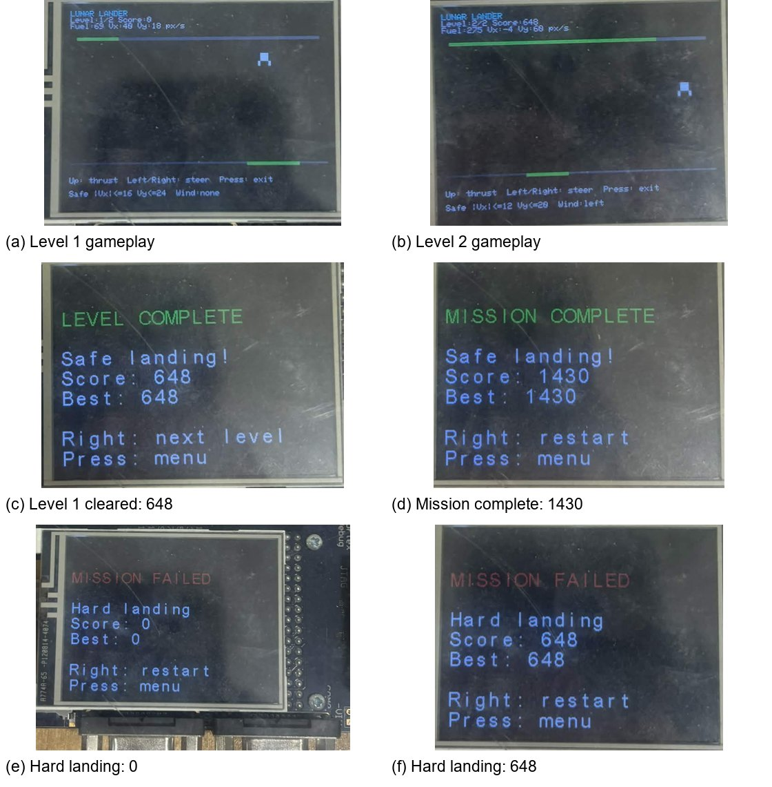
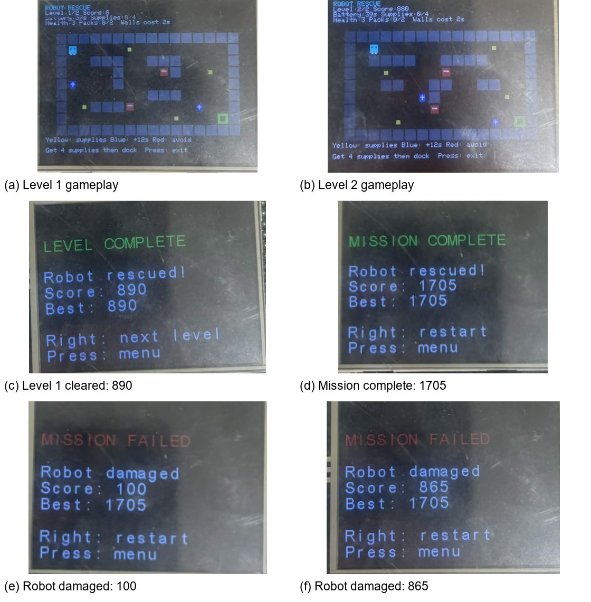
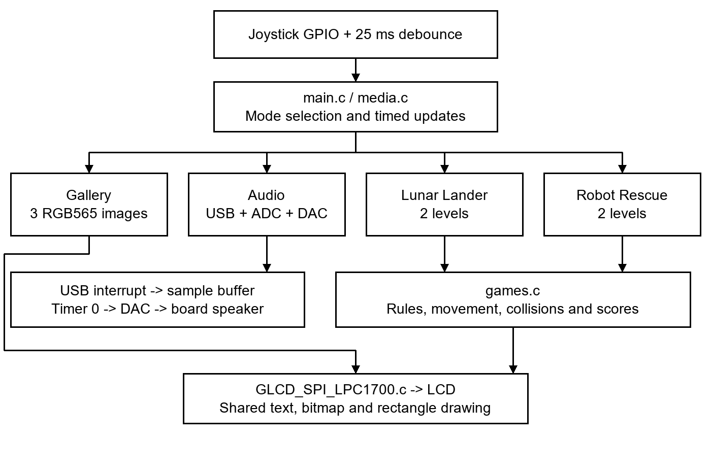

# Mission Control Media Center

**Embedded C | ARM Cortex-M3 | GPIO | ADC/DAC | Interrupts | Finite-State Machines**

A space-themed embedded media center running on the **Keil MCB1700 / NXP LPC1768**. A joystick-controlled LCD interface combines a photo gallery, two animated two-level games, and an audio interface in one bare-metal application.

Built for **COE718: Embedded Systems Design at Toronto Metropolitan University** by **Shayaan Rashedin**.

## At a glance

- **Two playable games:** Lunar Lander and Robot Rescue, each with two levels, cumulative scoring, and success/failure screens.
- **Hardware integration:** five-way joystick, color LCD, potentiometer, timer-driven DAC output, and the on-board speaker.
- **Predictable control flow:** a foreground state machine, debounced input, and nominal 50 ms game updates.
- **Practical debugging:** a local speaker test separates the working audio-output path from the unresolved USB connection.

| Lunar Lander on the board | Robot Rescue on the board |
| --- | --- |
|  |  |

The photographs show separate hardware trials, including both levels and successful and failed missions. Scores vary between runs.

## Features

### Lunar Lander

Steer a spacecraft onto a landing pad while managing thrust, fuel, horizontal drift, and touchdown speed. Level 2 introduces a narrower pad, lower fuel allowance, stricter landing-speed limits, and alternating wind. Fixed-point integer physics keeps the update loop compact.

### Robot Rescue

Navigate a 16 x 9 maze, collect four supplies, and reach the dock before the battery expires. Moving hazards reduce health and battery, blue packs restore battery time, and wall collisions carry a time penalty. The second level changes the map, shortens the battery allowance, and speeds up hazards.

### Photo gallery and audio interface

Browse three RGB565 space images using the joystick. In the audio interface, the potentiometer controls volume and a local 440 Hz test tone exercises the speaker output path. USB audio support is integrated, but PC-to-board streaming was not successfully demonstrated.

## Engineering skills demonstrated

| Area | Implementation |
| --- | --- |
| Embedded C | Modular application code, fixed-size state, bit masks, and integer arithmetic |
| Hardware interfaces | Direct register configuration of joystick GPIO, ADC, DAC, timers, and USB support |
| Input handling | Active-low inputs, 25 ms debounce, press events, and held-key controls |
| Timing and interrupts | SysTick timekeeping, nominal 20 Hz game updates, and a configured 32 kHz audio timer |
| Graphics | RGB565 image arrays, bitmap rendering, sprites, HUDs, and selective object redraws |
| State machines | Shared menu navigation, feature entry/exit, level progression, restart, and result states |
| Resource management | Fuel, battery, health, collectible masks, and per-game session best scores |
| Hardware debugging | Board trials, photographed outcomes, USB host messages, and an independent speaker test |

## Architecture

`main.c` initializes the board, reads and debounces the joystick, and supplies elapsed time to the application. `media.c` owns the menu, mode transitions, and drawing. `games.c` contains game rules independently of the LCD routines. The audio subsystem uses USB support code, a sample ring buffer, and a timer interrupt for DAC output.

The game loop drops excess delay instead of running a burst of catch-up frames. Timing figures describe configured intervals, not measured worst-case execution guarantees. This application uses a foreground loop and interrupts rather than an RTOS.

## Hardware results and current status

| Feature | Status |
| --- | --- |
| Menu navigation and return controls | Verified through board use |
| Three-image gallery | Displayed and browsed on the LCD |
| Both levels of both games | Played on the board, with completion and failure results photographed |
| Local speaker tone and potentiometer volume | Audible output and volume adjustment confirmed on the board |
| USB PC audio streaming | Incomplete: host enumeration failed |
| USB disconnect after a successful stream | Not verified because enumeration did not succeed |

USB troubleshooting also used a separate build based on the course USB Audio example, which failed to enumerate in the available setup. The observed errors do not establish a single root cause. The board receives PCM in the intended design. It does not decode MP3 files locally.

High scores are stored in RAM and reset when the board resets.

## Build and run

1. Install Keil MDK / uVision with **Arm Compiler 5** support. The project records **V5.06 update 6 (build 750)** and the **Keil LPC1700 device pack 2.6.0**.
2. Open [`firmware/MediaCenter.uvprojx`](firmware/MediaCenter.uvprojx).
3. Select the `MediaCenter` target and build the project.
4. Connect a compatible MCB1700/LPC1768 board through the configured ULINK debugger, download the firmware, and run it.
5. Use Up/Down to select a feature and press the joystick centre to open it.

The repository includes the source, startup code, device headers, image data, and scatter file. It does not include the Keil compiler, device-pack installer, or generated build output. See the [setup and controls guide](docs/SETUP.md) for details.

## Explore the code

- [Board setup and input](firmware/main.c)
- [Application states and display](firmware/media.c)
- [Game rules and level data](firmware/games.c)
- [Audio lifecycle and sample output](firmware/usbdmain.c)
- [LCD driver](firmware/GLCD_SPI_LPC1700.c)
- [Gallery images](docs/images/gallery.jpg)

## Credits

The menu, screen integration, gallery resources, and game logic form the application layer. Peripheral support was adapted from the COE718 LCD_Blinky, USBAudio, and common examples, with Arm/Keil and NXP device and startup support. This repository does not claim that the supplied support files were authored from scratch for this project. Third-party material remains subject to its applicable terms, and no blanket license is applied to those files.
